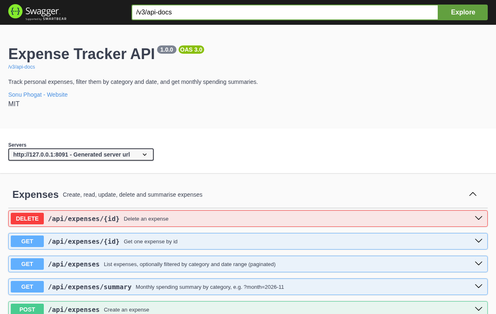

# 💶 Expense Tracker REST API

[](https://github.com/sonu2002/expense-tracker-api/actions/workflows/ci.yml)


A production-style **REST API** for tracking personal expenses, built with **Spring Boot 3**. It supports full CRUD, filtering, pagination, input validation, consistent error responses, **monthly spending summaries by category**, interactive API docs, automated tests, and Docker / PostgreSQL support.



## ✨ Features
- **CRUD** for expenses: `POST`, `GET`, `PUT`, `DELETE`
- **Filtering and pagination**: by category and date range, sortable, page size capped at 100
- **Monthly summary**: total spend, number of expenses, and a per-category breakdown with percentages (aggregated in the database with JPQL `GROUP BY`)
- **Validation** with Jakarta Bean Validation: positive amounts, max 2 decimals, no future dates, length limits
- **Consistent errors** as RFC 7807 `ProblemDetail` JSON, with field-level messages
- **OpenAPI / Swagger UI** documentation, generated automatically
- **Health check** via Spring Boot Actuator
- **10 automated tests** (unit + integration with MockMvc), JaCoCo coverage report (about 80%)
- **CI** with GitHub Actions on every push
- **Docker**: multi-stage build, runs as a non-root user, `docker compose` with PostgreSQL

## 🛠️ Tech stack
`Java 17` · `Spring Boot 3` · `Spring Web` · `Spring Data JPA / Hibernate` · `Bean Validation` · `H2` · `PostgreSQL` · `springdoc-openapi` · `JUnit 5` · `Mockito` · `MockMvc` · `JaCoCo` · `Maven` · `Docker` · `GitHub Actions`

## 🏗️ Architecture
```
Controller  ──►  Service  ──►  Repository  ──►  Database (H2 / PostgreSQL)
   │               │               │
 DTOs +         business       Spring Data JPA
 validation     rules,         + custom JPQL
                summaries      aggregation
        ▲
GlobalExceptionHandler → RFC 7807 error responses
```
```
src/main/java/com/sonuphogat/expensetracker/
├── expense/   Expense (entity), ExpenseRequest/Response (DTO records), MonthlySummary,
│              ExpenseRepository, ExpenseService, ExpenseController, Category
└── common/    GlobalExceptionHandler, NotFoundException, OpenApiConfig, DemoDataLoader
```

## 🚀 Run it
**Option 1: Java 17 only (in-memory database with sample data)**
```bash
./mvnw spring-boot:run -Dspring-boot.run.profiles=demo        # Windows: mvnw.cmd ...
```
**Option 2: Docker with PostgreSQL**
```bash
docker compose up --build
```
Then open **http://localhost:8080/swagger-ui.html** to try every endpoint in the browser.

## 📡 API
| Method | Endpoint | Description |
|---|---|---|
| `POST` | `/api/expenses` | Create an expense → `201 Created` + `Location` header |
| `GET` | `/api/expenses/{id}` | Get one expense |
| `GET` | `/api/expenses?category=FOOD&from=2026-11-01&to=2026-11-30&page=0&size=20` | Filter + paginate |
| `PUT` | `/api/expenses/{id}` | Update an expense |
| `DELETE` | `/api/expenses/{id}` | Delete → `204 No Content` |
| `GET` | `/api/expenses/summary?month=2026-11` | Monthly summary by category |

**Create:**
```bash
curl -X POST http://localhost:8080/api/expenses -H "Content-Type: application/json" \
  -d '{"title":"Weekly groceries","amount":54.90,"category":"FOOD","spentOn":"2026-11-10","note":"REWE"}'
```
**Monthly summary response:**
```json
{
  "month": "2026-11",
  "total": 869.89,
  "numberOfExpenses": 7,
  "byCategory": [
    { "category": "RENT", "total": 650.00, "count": 1, "percentage": 74.7 },
    { "category": "FOOD", "total": 63.40, "count": 2, "percentage": 7.3 }
  ]
}
```
**Validation error:**
```json
{
  "title": "Validation failed",
  "status": 400,
  "detail": "One or more fields are invalid",
  "errors": { "title": "must not be blank", "amount": "must be greater than or equal to 0.01" }
}
```
Categories: `FOOD, RENT, TRANSPORT, UTILITIES, SHOPPING, HEALTH, EDUCATION, ENTERTAINMENT, TRAVEL, OTHER`

## 🧪 Tests
```bash
./mvnw verify          # runs all tests + writes the coverage report to target/site/jacoco/index.html
```
| Test class | Type | What it covers |
|---|---|---|
| `ExpenseServiceTest` | Unit (Mockito) | summary maths and percentages, empty month, not-found, invalid date range |
| `ExpenseApiIntegrationTest` | Integration (MockMvc + H2) | full CRUD lifecycle, validation errors, unknown category, filtering, summary, health |

## ⚙️ Configuration
| Variable | Default | Purpose |
|---|---|---|
| `DB_URL` | `jdbc:h2:mem:expenses` | JDBC URL (use PostgreSQL in production) |
| `DB_USER` / `DB_PASSWORD` | `sa` / *(empty)* | Database credentials, **never hard-coded** |
| `PORT` | `8080` | HTTP port |
| `SPRING_PROFILES_ACTIVE` | *(none)* | `demo` loads sample data |

## 🔭 Possible next steps
User accounts with Spring Security + JWT · budgets with alerts · CSV export · Flyway migrations · Testcontainers for PostgreSQL integration tests

---
Made by **[Sonu Phogat](https://github.com/sonu2002)** · [LinkedIn](https://www.linkedin.com/in/sonuphogat) · MIT licence
